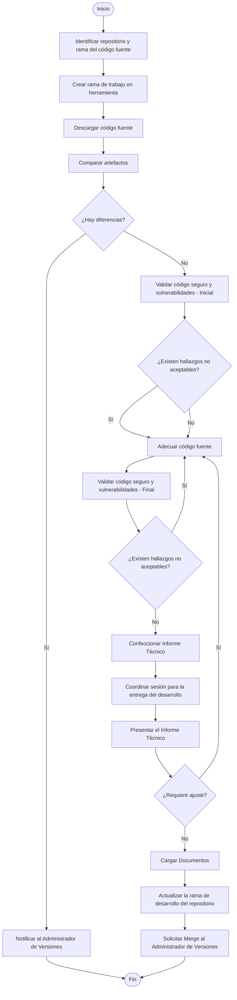

## Entradas, Salidas y Registros

| Entradas | Proceso | Salidas | Registros |
|-----------|----------|----------|------------|
| - FMR-DES-003 Requerimientos del Usuario, o requerimiento de usuario del proveedor. - FMR-DES-002 Documento de Análisis y Diseño. - Manual de Arquitectura Técnica, según aplique. | Adecuación Tecnológica | - FMR-ARQ-004 Minuta de Reunión. - FMR-CCL-002 Manual de Instalación. - FMR-DES-005 Informe Técnico de Adecuaciones Tecnológicas. - Evidencia de revisión de código seguro y vulnerabilidades. | - FMR-ARQ-004 Minuta de Reunión. - FMR-CCL-002 Manual de Instalación. - FMR-DES-005 Informe Técnico de Adecuaciones Tecnológicas. - Evidencia de revisión de código seguro y vulnerabilidades. |

## Diagrama de Flujo

## Descripción del Procedimiento

| Paso | Responsable | Actividad |
|--------|--------|--------|
| 1 | Analista Desarrollador | Identificar el repositorio y la rama del código fuente a modificar.  **Nota:** Para identificar el repositorio del código fuente se debe utilizar el nombre de la(s) aplicaciones a modificar durante el procedimiento de Análisis y Diseño de Aplicaciones. |
| 2 | Analista Desarrollador | Crear la rama de trabajo en la herramienta de versionamiento de TELERED. |
| 3 | Analista Desarrollador | Descargar el código fuente a modificar al equipo local. |
| 4 | Analista Desarrollador | Cuando aplique, realizar compare de los artefactos descargados versus los artefactos de producción. |
| 5 | Analista Desarrollador | Determinar si existen modificaciones en esta comparación.  **Sí:** Notificar al Administrador de Versiones y finalizar el procedimiento. **No:** Continuar con el siguiente paso. |
| 6 | Analista Desarrollador | Realizar una validación inicial de código seguro y vulnerabilidades sobre los artefactos descargados y conservar la evidencia generada. |
| 7 | Analista Desarrollador | Evaluar los resultados de la validación inicial.  **Existen hallazgos no aceptables:** Incorporar los ajustes requeridos al trabajo a realizar durante la adecuación. **No existen hallazgos no aceptables:** Continuar con el siguiente paso.  **Nota:** Los hallazgos aceptados por riesgo deberán documentarse según el procedimiento vigente de gestión de riesgos. |
| 8 | Analista Desarrollador | Realizar las adecuaciones a nivel del código fuente, incluyendo la atención de los hallazgos identificados durante la validación inicial que formen parte del alcance del trabajo. |
| 9 | Analista Desarrollador | Revisar que se han codificado cada una de las funcionalidades solicitadas. |
| 10 | Analista Desarrollador | Realizar una validación final de código seguro y vulnerabilidades sobre el código fuente modificado y conservar la evidencia generada. |
| 11 | Analista Desarrollador | Evaluar los resultados de la validación final.  **Existen hallazgos no aceptables:** Realizar las correcciones necesarias y regresar al paso 8. **No existen hallazgos no aceptables:** Continuar con el siguiente paso.  **Nota:** Los hallazgos aceptados por riesgo deberán documentarse según el procedimiento vigente de gestión de riesgos. |
| 12 | Analista Desarrollador | Confeccionar el Informe Técnico con el detalle de las adecuaciones realizadas. Como mínimo debe incluir:  - Checklist de adecuaciones realizadas. - Verificaciones del funcionamiento de las adecuaciones. - Resultado de las validaciones de seguridad realizadas. - Referencia a las evidencias generadas. - Si aplica, lista de parámetros nuevos. - Si aplica, requerimientos técnicos para el equipo donde se ejecutará la aplicación. |
| 13 | Analista Desarrollador | Coordinar sesión con los interesados para formalizar la entrega del desarrollo realizado. |
| 14 | Analista Desarrollador | Presentar el Informe Técnico a los interesados.  **Nota:** Si durante la presentación se identifica alguna inconsistencia, regresar al paso 8. De lo contrario, continuar con el siguiente paso. |
| 15 | Analista Desarrollador | Subir los siguientes documentos al repositorio:  - Manual de Instalación. - Informe Técnico. - Evidencia de revisión de código seguro y vulnerabilidades. |
| 16 | Analista Desarrollador | Actualizar la rama de desarrollo del repositorio. |
| 17 | Analista Desarrollador | Solicitar el merge al Administrador de Versiones. |