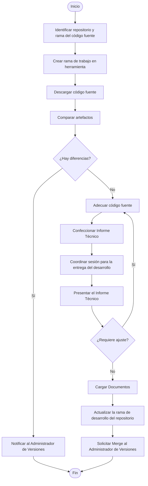

# P-DES-003 - Procedimiento para la Gestión de Adecuación Tecnológica

| Dato | Valor |
|--------|--------|
| Código | P-DES-003 |
| Versión | 3.0.1 |
| Área | Desarrollo |
| Fecha | 12/08/2024 |
| Revisión | 21/08/2026 |

## Propósito

El propósito de este procedimiento es establecer los pasos necesarios para realizar adecuaciones tecnológicas a nivel de las aplicaciones y/o sistemas que brindan servicios a los clientes de TELERED.

## Alcance

Este procedimiento aplica para cuando la adecuación tecnológica se realiza sobre código fuente que es propiedad de TELERED.

## Entradas, Salidas y Registros

| Entradas | Proceso | Salidas | Registros |
|-----------|----------|----------|------------|
| - FMR-DES-003 Requerimientos del Usuario, o requerimiento de usuario del proveedor.<br>- FMR-DES-002 Documento de Análisis y Diseño.<br>- Manual de Arquitectura Técnica, según aplique. | Adecuación Tecnológica | - FMR-ARQ-004 Minuta de Reunión.<br>- FMR-CCL-002 Manual de Instalación.<br>- FMR-DES-005 Informe Técnico de Adecuaciones Tecnológicas. | - FMR-ARQ-004 Minuta de Reunión.<br>- FMR-CCL-002 Manual de Instalación.<br>- FMR-DES-005 Informe Técnico de Adecuaciones Tecnológicas. |

## Diagrama de Flujo

```text
Inicio
  |
  v
[Identificar repositorio y rama del código fuente]
  |
  v
[Crear rama de trabajo en herramienta]
  |
  v
[Descargar código fuente]
  |
  v
[Comparar artefactos]
  |
  v
<¿Hay diferencias?>
  |--------------------- Sí ----------------------+
  |                                                |
  No                                               v
  |                                    [Notificar al Administrador
  |                                         de Versiones]
  |                                                |
  |                                                v
  |                                              Fin
  |
  v
[Adecuar código fuente]
  |
  v
[Confeccionar Informe Técnico]
  |
  v
[Coordinar sesión para la entrega del desarrollo]
  |
  v
[Presentar el Informe Técnico]
  |
  v
<¿Requiere ajuste?>
  |-------------------- Sí --------------------+
  |                                             |
  |                                             v
  |                                  (Regresar a "Adecuar código fuente")
  |
  No
  |
  v
[Cargar Documentos]
  |
  v
[Actualizar la rama de desarrollo del repositorio]
  |
  v
[Solicitar Merge al Administrador de Versiones]
  |
  v
Fin
```



## Descripción del Procedimiento

| Paso | Responsable | Actividad |
|--------|--------|--------|
| 1 | Analista Desarrollador | Identificar el repositorio y la rama del código fuente a modificar.<br><br>**Nota:** Para identificar el repositorio del código fuente se debe utilizar el nombre de la(s) aplicaciones a modificar durante el procedimiento de Análisis y Diseño de Aplicaciones. |
| 2 | Analista Desarrollador | Crear la rama de trabajo en la herramienta de versionamiento de TELERED. |
| 3 | Analista Desarrollador | Descargar el código fuente a modificar al equipo local. |
| 4 | Analista Desarrollador | Cuando aplique, realizar compare de los artefactos descargados versus los artefactos de producción. |
| 5 | Analista Desarrollador | Determinar si existen modificaciones en esta comparación.<br><br>**Sí:** Notificar al Administrador de Versiones y finalizar el procedimiento.<br>**No:** Continuar con el siguiente paso. |
| 6 | Analista Desarrollador | Realizar las adecuaciones a nivel del código fuente. |
| 7 | Analista Desarrollador | Revisar que se han codificado cada una de las funcionalidades solicitadas. |
| 8 | Analista Desarrollador | Confeccionar el Informe Técnico con el detalle de las adecuaciones realizadas. Como mínimo debe incluir:<br><br>- Checklist de adecuaciones realizadas.<br>- Verificaciones del funcionamiento de las adecuaciones.<br>- Si aplica, lista de parámetros nuevos.<br>- Si aplica, requerimientos técnicos para el equipo donde se ejecutará la aplicación. |
| 9 | Analista Desarrollador | Coordinar sesión con los interesados para formalizar la entrega del desarrollo realizado. |
| 10 | Analista Desarrollador | Presentar el Informe Técnico a los interesados.<br><br>**Nota:** Si durante la presentación se identifica alguna inconsistencia, regresar al paso 6. De lo contrario, continuar con el siguiente paso. |
| 11 | Analista Desarrollador | Subir los siguientes documentos al repositorio:<br><br>- Manual de Instalación.<br>- Informe Técnico. |
| 12 | Analista Desarrollador | Actualizar la rama de desarrollo del repositorio. |
| 13 | Analista Desarrollador | Solicitar el merge al Administrador de Versiones. |

## Documentos de Referencia

| Documento | Código |
|------------|---------|
| Manual de Instalación | FMR-CCL-002 |
| Informe Técnico de Adecuaciones Tecnológicas | FMR-DES-005 |
| Minuta de Reunión | FMR-ARQ-004 |
